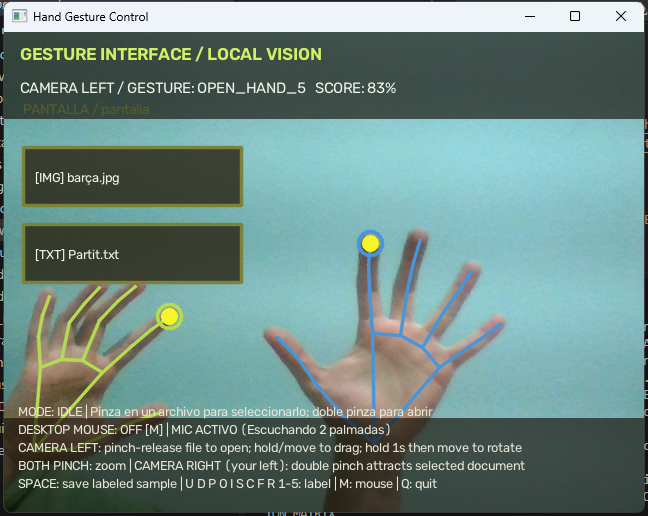

# Hand Gesture Control 🖐️💻

A real-time, standalone computer vision and audio application built with **OpenCV**, **MediaPipe**, and **SoundDevice**. Control a futuristic floating HUD document viewer and interact with your Windows desktop mouse using hand gestures captured via your webcam, plus acoustic clap detection through your microphone.

100% local processing — **no API keys, no external cloud dependencies, no AI subscriptions required**.

---

<!-- PREVIEW SCREENSHOT -->
<div align="center">
  
  <p><em>Real-time HUD with 3D floating panel, hand tracking, file explorer, and live microphone status.</em></p>
</div>

---

## ✨ Features

- **MediaPipe Hand Landmarking**: Fast 21-point 3D hand tracking powered by the local Google MediaPipe model (`hand_landmarker.task`).
- **Geometric Gesture Classifier**: Instant heuristic recognition for gestures:
  - 🤏 **Pinch**: Open file / Select / Drag & Move.
  - 🖐️ **Open Hand / Pointing**: Navigation and targeting.
  - 👐 **Palmas Juntas (Palm-to-Palm)**: Bringing palms together restores the HUD, reorders file tiles, and resets panel scale/position back to initial state.
  - 🤘 **ROCK Gesture**: Opens a motivational YouTube short in Chrome.
  - 👐 **Bimanual Controls**: Two-hand pinch to zoom and rotate the floating document in 3D.
- **Acoustic Double-Clap Detection (Microphone)**:
  - 👏 **2 Palmadas por Sonido**: Listens to the microphone in real time via `sounddevice`. Clapping twice within 1.0s launches the AC/DC song (*Thunderstruck*) in Chrome, **even if your hands are off-camera or not visible**.
  - Shows live microphone status right in the HUD status bar.
- **Interactive 3D HUD & File Browser**:
  - Browse local files and images inside the `pantalla/` folder.
  - Render transformed document textures in 3D perspective directly over the video stream.
- **Desktop Mouse Emulation** (`M` key):
  - Toggle desktop mouse control using Windows `user32` APIs.
  - Index fingertip guides the cursor with smoothing.
  - Pinch gesture triggers click and drag.

---

## 📋 System Requirements & Compatibility

> [!IMPORTANT]
> **Python Version**: **Python 3.10, 3.11, or 3.12 (64-bit)** is required.  
> *Python 3.13 is currently not supported by MediaPipe.*

- **OS**: Windows 10 / 11 (required for desktop mouse control via `user32.dll`).
- **Hardware**: Standard laptop webcam or USB camera, and a microphone.
- **Browser**: Google Chrome (optional, used by the ROCK and Double Clap song shortcuts).

---

## 🚀 Quick Start

### 1. Clone the repository

```powershell
git clone https://github.com/YOUR_USERNAME/hand-gesture-control.git
cd hand-gesture-control
```

### 2. Create and activate a Python 3.12 virtual environment

```powershell
py -3.12 -m venv .venv
.\.venv\Scripts\Activate.ps1
```

> **Tip (PowerShell permission error):** If you see an error about script execution being disabled, run:
> ```powershell
> Set-ExecutionPolicy -ExecutionPolicy RemoteSigned -Scope CurrentUser
> ```
> Or invoke Python directly without activating: `.\.venv\Scripts\python.exe main.py`

### 3. Install dependencies

```powershell
pip install -r requirements.txt
```

*(The MediaPipe model `hand_landmarker.task` is already bundled inside the repository, so no additional downloads are needed).*

### 4. Run the project

```powershell
python main.py
```

Or run directly using the virtual environment interpreter:
```powershell
.\.venv\Scripts\python.exe main.py
```

---

## 🎮 Controls & Gestures

| Action / Gesture | Type | Description |
| :--- | :--- | :--- |
| **Pinch (Index + Thumb)** | Vision | Select file, open folder, or grab and drag the 3D document panel. |
| **Palmas Juntas (Palm-to-Palm)** | Vision | Bring palms together in camera view to reset the HUD and reorder all files back to initial layout. |
| **2 Palmadas (Double Clap 👏)** | **Audio / Mic** | Clap twice (detected by microphone, works even off-camera) to launch the AC/DC song (*Thunderstruck*) in Chrome. |
| **Two-Hand Pinch** | Vision | Zoom in/out or rotate the document panel in 3D space. |
| **ROCK Gesture (🤘)** | Vision | Held for 3+ frames to open the motivation short in Chrome. |
| **Keyboard: `M`** | Input | Toggle Windows desktop mouse control mode. |
| **Keyboard: `Q`** | Input | Quit application. |

---

## 📂 Project Structure

```text
├── assets/                 # Screenshots and media for documentation
│   └── demo.png            # Main preview image for README
├── pantalla/               # Local folder where documents/images are browsed
│   └── .gitkeep            # Preserves directory structure in Git
├── tests/                  # Automated test suite (55 unit tests)
│   ├── test_audio_detector.py
│   ├── test_browser_actions.py
│   ├── test_gestures.py
│   ├── test_hand_tracking.py
│   ├── test_hud_renderer.py
│   ├── test_interaction_state.py
│   ├── test_main.py
│   ├── test_mouse_control.py
│   └── test_screen_library.py
├── audio_detector.py       # Real-time microphone clap and double-clap acoustic detector
├── browser_actions.py      # Browser automation for gesture shortcuts
├── gestures.py             # Geometric heuristics for gesture classification
├── hand_landmarker.task    # Bundled MediaPipe hand detection model
├── hand_tracking.py        # Video-mode landmarker wrapper
├── hud_renderer.py         # OpenCV HUD and 3D wireframe/texture projection
├── interaction_state.py    # Finite state machine managing UI interactions
├── main.py                 # Application entry point and camera pipeline
├── mouse_control.py        # Windows cursor mapping and smoothing
├── requirements.txt        # Pinned project dependencies
└── screen_library.py       # Safe file system explorer for pantalla/
```

---

## 🧪 Running Tests

Run the full automated test suite (all tests execute without needing camera hardware):

```powershell
.\.venv\Scripts\python.exe -m unittest discover tests
```

---

## 📄 License

This project is licensed under the MIT License - see the LICENSE file for details.
